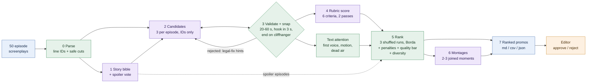

# SnipDeck architecture

Core rule: **the LLM only ever returns line IDs (e.g. `E07_L042`); code computes, snaps and validates every timestamp.**
Values below are the current `config.yaml` (official run C = `llm-run-5`).

```mermaid
flowchart TD
    subgraph IN["INPUTS"]
        EPS["Episode screenplays<br/>episode-001..050 .txt<br/>CAMERA / ACTION / SOUND FX / NAME (Emotion)<br/>Start: (mm:ss.ss) | End: (mm:ss.ss)"]
        CFG["config.yaml<br/>providers, per-stage model + fallbacks,<br/>temperature, reasoning_effort,<br/>rules, score weights"]
        KEY[".env / app key box<br/>GEMINI_API_KEY (gitignored)"]
        SHOW["Show title<br/>(folder or zip name)"]
    end

    subgraph UI["ENTRY POINTS"]
        CLI["scripts/run.py<br/>check: 1 ping per model, lists valid models<br/>run: --no-llm, --profile, --no-montage,<br/>--fresh-stages, --cache-dir, --run-id"]
        APP["web/ (static site, Pyodide)<br/>zip, .txt or .srt upload<br/>provider + model swap, speed profile<br/>review desk: Approve / Reject per promo"]
    end


    subgraph S0["STAGE 0 - parse.py (code)"]
        P1["Regex block parser<br/>Line{id E07_L042, kind, speaker, emotion,<br/>text, start, end, scene}"]
        P2["cut_ok(t): t not strictly inside a<br/>DIALOGUE or SFX line<br/>next_safe_after / prev_safe_before"]
        P3["compact(): LLM view<br/>E07_L012 [00:12.3] JULIANA (Cold): ..."]
        P1 --> P2
        P1 --> P3
    end

    subgraph LLMBOX["llm.py - model-agnostic client"]
        LLMC["OpenAI SDK -> any OpenAI-compatible endpoint<br/>(Gemini, Groq, OpenRouter, OpenAI, Kuku gateway)"]
        CACHE[("Disk cache .cache/<br/>key = sha256(base_url, model, temp,<br/>messages, reasoning_effort)<br/>re-runs cost 0 calls")]
        RETRY["Retry + backoff on 429/5xx/timeout (300 s)<br/>404 -> next model; daily quota -> dead_models.json<br/>min_interval 7 s; JSON + Pydantic validation,<br/>1 retry showing the invalid reply"]
        LOG["Call log: tokens in/out + hidden<br/>thinking tokens (total - in - out)"]
        LLMC <--> CACHE
        LLMC --- RETRY
        LLMC --> LOG
    end

    subgraph HB["heuristics.py (code, 0 API calls)"]
        H1["Sliding windows 20-60 s<br/>score = 2*hook + 2*cliff + 3*intensity<br/>keywords, hot emotion tags, ! ? ..."]
        H2["Backstop: 1 per episode (LLM mode)<br/>Baseline: 3 per episode (--no-llm)"]
        H1 --> H2
    end

    subgraph S1["STAGE 1 - story bible (gemini-3.8-flash, temp 0)"]
        B1["Input: show title, loglines,<br/>continuity notes, speaker label counts"]
        BIB["Bible JSON: premise, genre tropes,<br/>characters + aliases, episode roles,<br/>selling_reveals, late_payoffs{what, episodes}"]
        SV["Spoiler vote: + 2 short passes (temp 0.5)<br/>episode = spoiler if named by >= 2 of 3<br/>(title twist never a spoiler)<br/>config late_payoff_episodes overrides"]
        B1 --> BIB --> SV
    end

    subgraph S2["STAGE 2 - candidates (gemini-3-flash-preview, reasoning_effort low)"]
        C1["1 call per episode: bible + compact episode<br/>3 moments, IDs only:<br/>start, hook, cliffhanger, end, answered_at,<br/>hook_type, cliffhanger_type, open_question, why"]
        C2["Repair call (per episode, if needed)<br/>ACCEPTED list + REJECTED reasons +<br/>HOW TO FIX: code-computed legal hook/end IDs<br/>tops the episode up to 3"]
        C3["Dedupe same moment (IoU >= 0.5)"]
    end

    subgraph S3["STAGE 3 - validate.py (code)"]
        V["build_single()<br/>IDs exist, same episode<br/>start <= hook <= cliff <= end<br/>hook is not a CAMERA line"]
        V2["Cut at the cliffhanger: drop later dialogue,<br/>keep silent reaction beats <= 3 s<br/>never run into answered_at line"]
        V3["Start snap: hook within 3 s (lead-in 0.3 s),<br/>search back for a safe cut<br/>End snap: +0.4 s tail, before next spoken line"]
        V4{"20-60 s and<br/>hook in first 3 s?"}
        V5["Invalid(reason, hint)<br/>hint = legal hook lines for this ending<br/>or legal endings for this hook"]
        V --> V2 --> V3 --> V4
        V4 -- no --> V5
    end

    MERGE["Candidate pool<br/>LLM candidates + non-overlapping backstop picks<br/>renumbered P001..Pnnn (run C: 138 valid)"]

    subgraph ATT["attention.py - text attention proxy (code)"]
        A1["First 3 s: time to first voice, cuts,<br/>close-up, motion/impact, sound spike,<br/>vocal intensity, direct address, stakes words"]
        A2["Whole clip: longest dead air, cuts per 10 s,<br/>speech share, ending beat<br/>(close-up / sting / open line)"]
        A3["hook_attention, hold (0-1)<br/>flags: no voice until Xs, dead air, flat final beat"]
        A1 --> A3
        A2 --> A3
    end

    subgraph S4["STAGE 4 - rubric score (gemini-3.8-flash, temp 0, full thinking)"]
        SC1["Batches of 40 clips, script excerpts (no CAMERA)<br/>evidence first: quote first 3 s + last lines<br/>calibrated: max two 5s per criterion, >= 25% get <= 2"]
        SC2["2 passes, batches reshuffled (seed 7+k)<br/>scores averaged, flag if any pass sets it"]
        SC3["6 criteria 1-5: hook_3s x3, cliffhanger x3,<br/>standalone x2, intensity x1, plot_relevance x1,<br/>trope_fit x1 -> composite 0-1<br/>flags: spoiler, ad_policy, needs_context"]
        SC1 --> SC2 --> SC3
    end

    subgraph S5["STAGE 5 - rank + select"]
        R1["Top 40 by composite -> listwise rank x3<br/>(shuffled order, seed 7; growth-lead persona:<br/>hook, cliffhanger, clarity, early episodes, no spoilers)"]
        R2["Borda count: position p earns N - p<br/>omitted ids share remaining positions<br/>borda = points / (runs * N)"]
        R3["final = 0.6*borda + 0.4*composite<br/>(x0.6 if outside the ranked pool)<br/>- 0.15 spoiler (judge flag OR vote episode)<br/>- 0.25 ad policy - 0.10 needs context<br/>- 0.10*(ep-1)/(N-1) late episode<br/>+ 0.15*(0.7*hook_att + 0.3*hold - 0.55)"]
        R4{"Quality bar<br/>hook_3s >= 2.5 and<br/>not needs_context?"}
        R5["Same scene: keep the higher final<br/>(overlap dedupe before diversity)"]
        R6["Greedy MMR: value = final - 0.35*sim<br/>sim 0.35 same episode, 0.15 same hook type<br/>max 2 per episode, up to 30 promos"]
        R1 --> R2 --> R3 --> R4
        R4 -- pass --> R5 --> R6
        R4 -- fail --> DROP["Kept in candidates_all.json,<br/>never in the final list"]
    end

    subgraph S6["STAGE 6 - montages (gemini-3.8-flash, temp 0.2)"]
        M1["Pool: top 12 eligible, minus spoiler<br/>and ad-policy clips; asks for up to 8<br/>2-3 parts of 6-20 s, story order"]
        M2["build_montage(): 2-3 segments, each >= 3 s,<br/>no overlap, hook in segment 1 first 3 s,<br/>cliffhanger in last segment, total 20-60 s"]
        M3["1 repair round with reasons -> dedupe<br/>-> rubric score -> final_order<br/>keep if bar passed and composite >= 0.5 (max 5)"]
        M1 --> M2 --> M3
    end

    subgraph S7["STAGE 7 - export.py -> outputs/show/run-id/"]
        E1["promos.md / promos.csv / promos.json<br/>episode + start/end per segment, hook, cliffhanger,<br/>open question, why, scores, flags, rank note,<br/>attention + flags, script excerpt"]
        E2["candidates_all.json: every valid clip +<br/>every rejection with reason and fix hint"]
        E3["story_bible.json, run_log.json:<br/>counts, spoiler vote, models used per stage,<br/>tokens incl. thinking, seconds"]
    end

    subgraph HUM["HUMAN IN THE LOOP"]
        ED["Editor reviews ranked picks in the web review desk<br/>Approve / Reject -> promos_with_approvals.csv"]
        TUNE["Future: tune score weights per genre;<br/>live A/B on hook rate, hold rate, CTR, CPI"]
        ED --> TUNE
    end

    subgraph EV["EVALUATION (scripts/eval/)"]
        EV1["evaluate.py: hard-rule re-check on saved output<br/>(duration, safe cuts, hook window, overlap,<br/>per-episode cap) + gold hit@k if labelled"]
        EV2["auto_eval.py: run-to-run agreement (IoU >= 0.5),<br/>blind A/B vs baseline (both orders)"]
        EV3["show_picks.py: picks with excerpts for audit"]
    end

    %% ---------------- CROSS-STAGE LINKS ----------------
    %% ---------------- INPUTS ----------------
    %% ---------------- ENTRY POINTS ----------------
    EPS --> CLI
    EPS --> APP
    CFG --> CLI
    CFG --> APP
    KEY --> LLMC
    SHOW --> BIB
    %% ---------------- STAGE 0 ----------------
    CLI --> P1
    APP --> P1
    %% ---------------- LLM CLIENT ----------------
    %% ---------------- BASELINE / BACKSTOP ----------------
    P1 --> H1
    %% ---------------- STAGE 1 ----------------
    P3 --> B1
    BIB -. calls .-> LLMC
    SV -. calls .-> LLMC
    %% ---------------- STAGE 2 ----------------
    C1 --> V
    V -- "rejected + hint" --> C2
    C2 --> V
    V -- valid --> C3
    BIB --> C1
    P3 --> C1
    C1 -. calls .-> LLMC
    C2 -. calls .-> LLMC
    %% ---------------- STAGE 3 ----------------
    P2 --> V3
    H2 --> V
    %% ---------------- MERGE + ATTENTION ----------------
    C3 --> MERGE
    V4 -- "yes (heuristic)" --> MERGE
    MERGE --> A1
    MERGE --> A2
    %% ---------------- STAGE 4 ----------------
    MERGE --> SC1
    SC1 -. calls .-> LLMC
    %% ---------------- STAGE 5 ----------------
    SC3 --> R1
    A3 --> R3
    SV --> R3
    R1 -. calls .-> LLMC
    %% ---------------- STAGE 6 ----------------
    R5 --> M1
    M1 -. calls .-> LLMC
    M3 -. calls .-> LLMC
    %% ---------------- STAGE 7 ----------------
    R6 --> E1
    M3 --> E1
    V5 --> E2
    MERGE --> E2
    BIB --> E3
    LOG --> E3
    %% ---------------- HUMAN + EVAL ----------------
    E1 --> ED
    TUNE -. adjusts .-> CFG
    E1 --> EV1
    E1 --> EV2
    E1 --> EV3
    %% ---------------- BASELINE PATH ----------------
    H2 -. "--no-llm: rule-based baseline<br/>(composite = heuristic score) -> R3 -> R5 -> R6" .-> R3

    %% ---------------- STYLES ----------------
    classDef ai fill:#efe7fb,stroke:#7b5cc4,color:#2b1d52
    classDef code fill:#e6f2ea,stroke:#3c8c5a,color:#14361f
    classDef io fill:#e8f0fb,stroke:#4a72b0,color:#152a4a
    classDef human fill:#fdf0e1,stroke:#c98a2c,color:#4a2f08
    classDef store fill:#f3f3f3,stroke:#777,color:#222
    class BIB,SV,B1,C1,C2,SC1,SC2,SC3,R1,M1 ai
    class P1,P2,P3,H1,H2,V,V2,V3,V4,V5,C3,MERGE,A1,A2,A3,R2,R3,R4,R5,R6,M2,M3,DROP,RETRY,LOG,EV1,EV2,EV3 code
    class EPS,CFG,KEY,SHOW,CLI,APP,E1,E2,E3,LLMC io
    class ED,TUNE human
    class CACHE store
```

Legend: purple = AI judgement (Gemini), green = deterministic code, blue = inputs, interfaces and outputs,
orange = human, grey = storage. Dotted arrows to `llm.py` = model calls (all cached).

## Compact version (for the 2-page doc)

